<div align="center">


# Steak Burger · Cardápio Digital

**Cardápio digital mobile-first para restaurantes:** rápido, bonito em qualquer tela, com PDF para download e QR Codes numerados para as mesas.

[**🌐 Ver ao vivo**](https://steakburger.forgedevapps.com) &nbsp;·&nbsp;
[**📄 Cardápio em PDF**](https://steakburger.forgedevapps.com/cardapio-steak-burger.pdf) &nbsp;·&nbsp;
[**🔳 QR Codes das mesas**](https://steakburger.forgedevapps.com/qrcodes-mesas-steak-burger.pdf)

[](https://github.com/ArturMineiro/stackburguer/actions/workflows/ci-cd.yml)


<br />

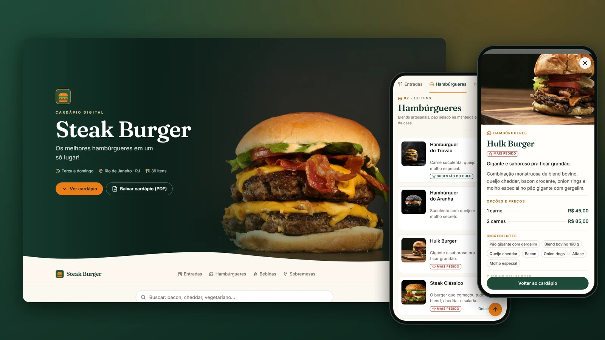

</div>

---

## ✨ Destaques

| | |
|---|---|
| 📱 **Mobile-first de verdade** | Pensado primeiro para o celular de quem escaneia o QR na mesa. Testado de **280 px** (Galaxy Fold fechado) a telas 4K, com áreas de toque ≥ 44 px, *safe areas* de iPhone com notch e modo paisagem. |
| 🍔 **Cardápio completo** | 39 itens em 4 categorias, com foto, descrição, **todos os ingredientes**, **variações com preço** (porções, tamanhos, quantidade de carnes), selos (Novidade, Mais pedido, Vegetariano, Picante, +18…), adicionais e combos. |
| 🔎 **Busca instantânea** | Ignora acentos e maiúsculas e procura em nome, descrição, ingredientes e tags (“bacon duplo”, “vegetariano”, “aipim”…). |
| 🧭 **Navegação por categorias** | Barra fixa que acompanha a rolagem e destaca a seção atual. |
| 🪟 **Detalhes do prato** | *Bottom sheet* no celular e janela no desktop. O botão **voltar** do celular fecha o detalhe sem sair do site, e cada prato tem link direto (`/#item-hulk-burger`). |
| 📄 **Baixar cardápio (PDF)** | PDF bonito, com capa, fotos, ingredientes e preços, gerado automaticamente a cada atualização do cardápio. |
| 🔳 **QR Codes das mesas** | Cartões A6 prontos para imprimir, com a identidade do restaurante e **número da mesa** (Mesa 01, 02…). Quem escaneia vê “Você está na mesa 07”. |
| 💬 **Prévia linda no WhatsApp** | Imagem 1200×630 gerada no build (< 300 KB, como o WhatsApp exige), mais Open Graph e Twitter Cards. |
| ⚡ **Rápido e leve** | Site estático, JS mínimo (~3 KB), fotos em **AVIF/WebP** no tamanho certo de cada tela, fontes locais com *fallback* otimizado (sem “pulo” do texto). |
| 🔒 **Seguro** | CSP com hashes, headers de segurança, nginx sem root, container somente leitura. |
| 🎨 **White-label** | Nome, cores, logo, contatos e cardápio ficam em arquivos de configuração: criar o cardápio de outro restaurante é trocar dados, não código. |
| 🚀 **Deploy automático** | Push na `main` → testes → build → publicação na Hostinger, com trava de segurança e confirmação da versão no ar. |

## 📸 Telas

<div align="center">

| Início | Cardápio | Detalhe do prato |
|:---:|:---:|:---:|
| 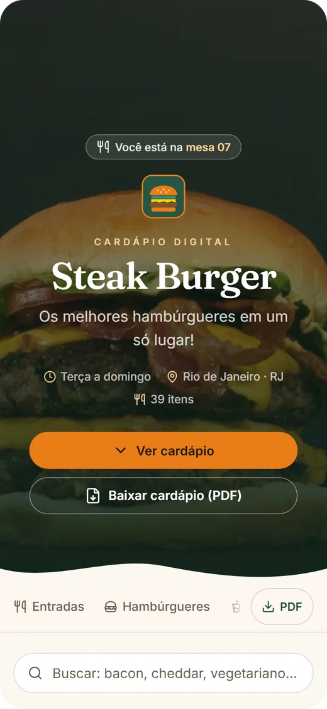 | 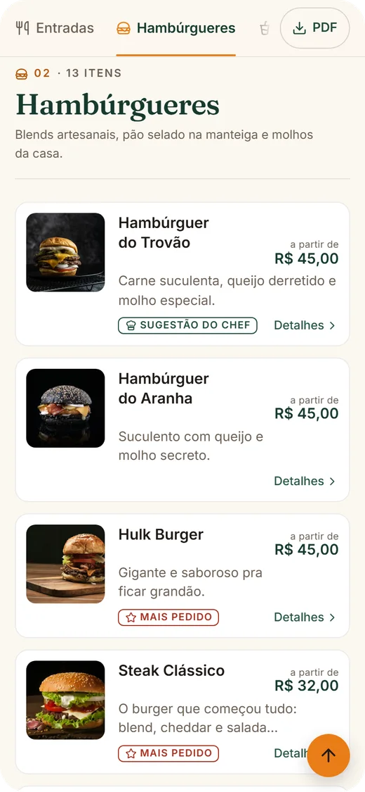 | 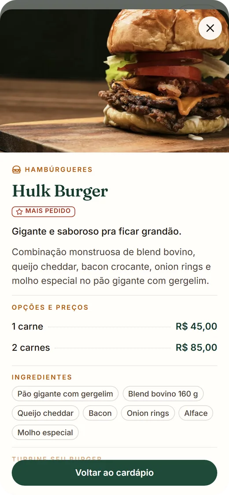 |

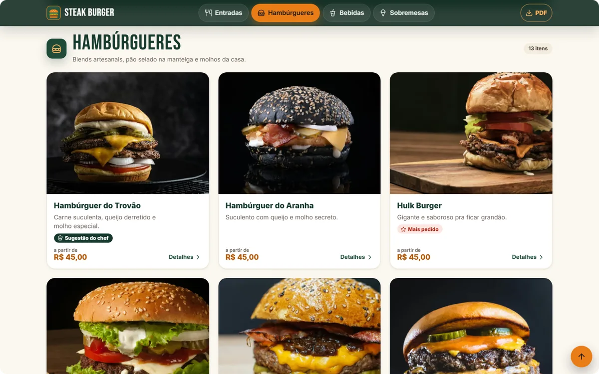

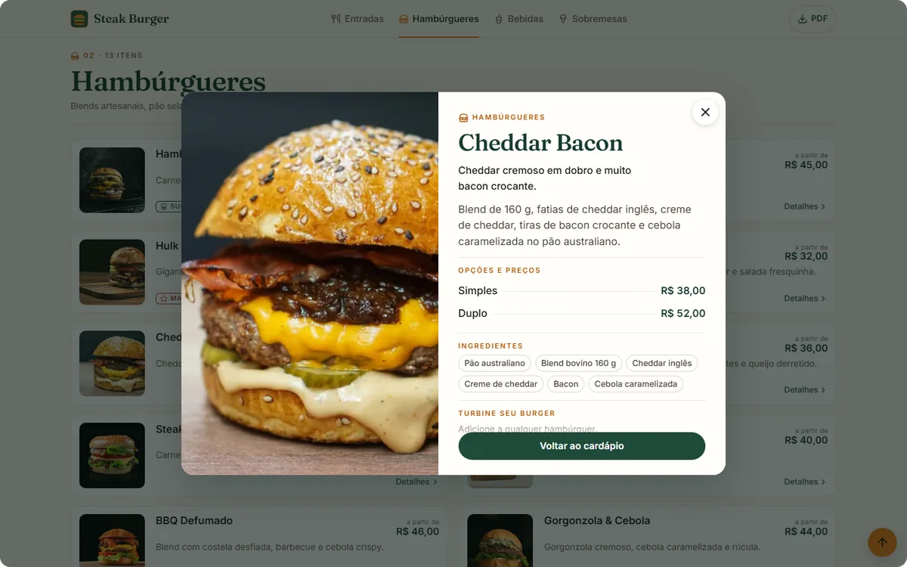

### PDF do cardápio e cartões de mesa

| Capa | Página interna | Contracapa | Cartões de mesa (A6) |
|:---:|:---:|:---:|:---:|
| 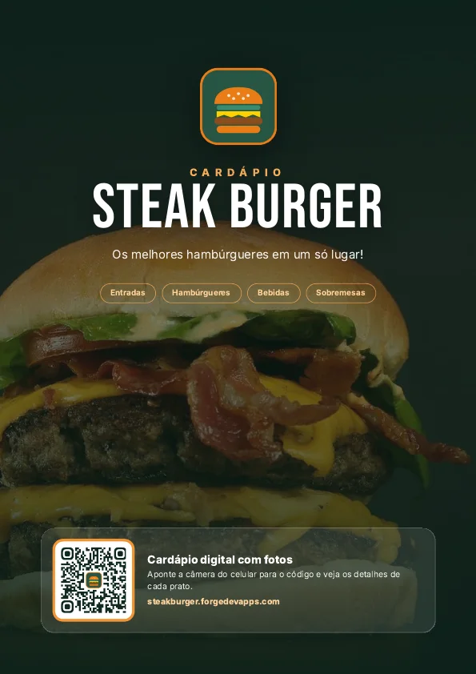 | 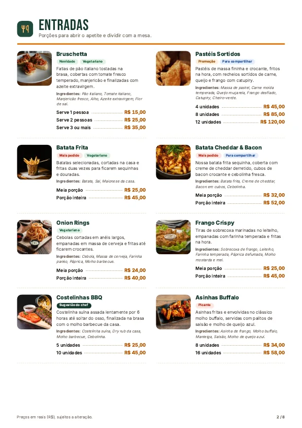 | 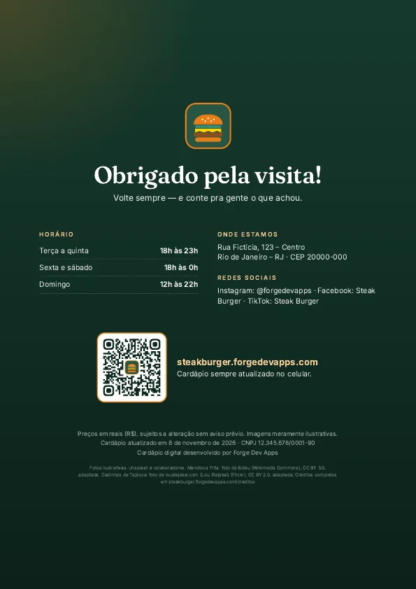 | 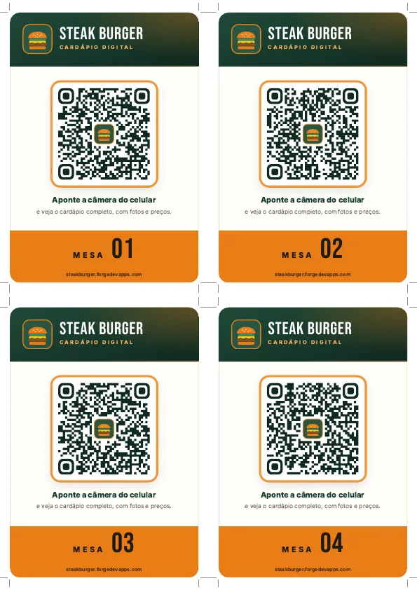 |

### Prévia do link (WhatsApp, Instagram, Facebook…)

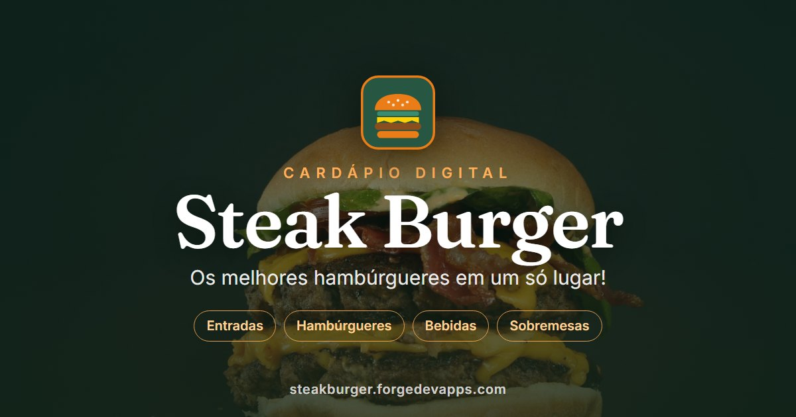

</div>

## 🧱 Stack

- **[Astro 7](https://astro.build)**: site estático, componentes `.astro`, otimização de imagens (sharp), API de fontes e CSP.
- **TypeScript** no modo `strictest`, com o cardápio validado por **Zod** (erro claro no build se faltar uma foto, um preço for inválido etc.).
- **CSS moderno** sem framework: tokens, `clamp()`, grid, `<dialog>`, `prefers-reduced-motion`.
- **Playwright** para os testes de ponta a ponta, a geração dos PDFs e a prévia do link; **Vitest** para os testes unitários; **axe-core** para acessibilidade.
- **Docker** com build multi-stage (Node + Chromium para os PDFs) servido por **nginx sem root**.
- **GitHub Actions** para o CI/CD com deploy via FTP na **Hostinger**.

## 🚀 Como rodar

### Requisitos

- **Node.js 22.12+** (o projeto usa `.nvmrc`)
- **Docker** (opcional, para rodar como em produção)

### Desenvolvimento local

```bash
npm install
npx playwright install chromium   # uma vez: usado para gerar os PDFs e rodar os testes
npm run dev                        # http://localhost:4321
```

### Com Docker

```bash
# Produção (build otimizado + nginx) → http://localhost:8080
docker compose up -d --build

# Desenvolvimento com hot reload, sem instalar Node na máquina → http://localhost:4321
docker compose --profile dev up dev
```

> O build de produção aceita `--build-arg MESAS=25` (quantidade de cartões de mesa) e `--build-arg SITE_URL=https://...`.

## 🧾 Editando o cardápio

Todo o cardápio fica em **[`src/data/cardapio.json`](src/data/cardapio.json)**. O VS Code autocompleta e valida os campos, e o build aponta qualquer erro (preço inválido, foto inexistente, id repetido…).

```jsonc
{
  "id": "batata-cheddar-bacon",              // único, em minúsculas e com hífens (vira o link /#item-...)
  "nome": "Batata Cheddar & Bacon",
  "descricao": "Batata frita coberta com cheddar cremoso e bacon crocante.",  // aparece no card
  "detalhes": "Nossa batata frita sequinha, coberta com creme de cheddar…",  // opcional, no detalhe
  "imagem": "batata-cheddar-bacon.jpg",      // arquivo em src/assets/cardapio/
  "ingredientes": ["Batata frita", "Creme de cheddar", "Bacon em cubos", "Cebolinha"],
  "opcoes": [                                 // variações; o card mostra "a partir de" o menor preço
    { "titulo": "Meia porção", "preco": 32 },
    { "titulo": "Porção inteira", "preco": 52 }
  ],
  "selos": ["mais-pedido", "compartilhar"],  // novidade, promo, mais-pedido, chef, vegetariano, picante, compartilhar, alcoolico
  "tags": ["fritas", "queijo"],               // sinônimos extras para a busca
  "nota": "Perfeita para dividir"
}
```

Cada categoria também pode ter `extras` (como **“Turbine seu burger”** e **“Vire combo”**), que aparecem na lista, no detalhe dos pratos e no PDF.

**Fotos novas:** coloque a foto original (JPG/PNG de qualquer tamanho) numa pasta e rode:

```bash
node scripts/prepare-photos.ts caminho/da/pasta
```

O script recorta em quadrado de forma inteligente (centralizando o prato), reduz para 1400 px e comprime. O site ainda gera AVIF/WebP no tamanho exato de cada tela.

## 🎨 Criando o cardápio de outro restaurante

1. **[`src/config/site.ts`](src/config/site.ts)**: nome, slogan, URL, endereço, CNPJ, horários, redes sociais e quantidade de mesas.
2. **[`src/styles/theme.css`](src/styles/theme.css)**: cores da marca (só esse arquivo).
3. **`src/assets/brand/logo.svg`** e **`public/favicon.svg`**: logo. Depois rode `npm run icons` para gerar os ícones do app.
4. **`src/assets/brand/hero.jpg`**: foto da capa (paisagem, ≥ 2000 px).
5. **`src/data/cardapio.json`** e as fotos em **`src/assets/cardapio/`**: o cardápio.
6. **`src/data/creditos.json`**: créditos das fotos (deixe `[]` se as fotos forem do próprio restaurante).

## 🖨️ PDF e QR Codes das mesas

Os arquivos são gerados a cada `npm run build` (por [`scripts/generate-assets.ts`](scripts/generate-assets.ts)) a partir de páginas HTML de impressão em `src/pages/imprimir/`. Para ajustar o visual, rode `npm run dev` e abra:

- `/imprimir/cardapio/`: PDF do cardápio (A4)
- `/imprimir/qrcodes/`: cartões de mesa (4 por folha A4, com marcas de corte)
- `/imprimir/og/`: imagem de prévia do link

**Quantidade de mesas:** `tableCards.count` em `src/config/site.ts`, ou na hora do build:

```bash
MESAS=25 npm run build
```

Cada QR leva ao site com `?mesa=NN`. As vagas que sobram na última folha recebem cartões gerais (balcão/entrada). Os QR Codes têm o logo no centro e correção de erro alta, e um teste automatizado **decodifica cada um** para garantir que escaneiam.

> **Dica de impressão:** papel couché 250–300 g, tamanho real (100%), e displays de acrílico A6.

## ✅ Qualidade e testes

```bash
npm run verify   # lint + formatação + tipos + testes unitários + build + e2e
```

- **Unitários (Vitest):** busca, formatação de preço, validação do cardápio (fotos, ids, ingredientes) e leitura real dos QR Codes.
- **E2E (Playwright):** Galaxy Fold 280 px, iPhone SE, Pixel 7, iPad e desktop (+ Safari/WebKit e Firefox no CI). Cobre ausência de rolagem horizontal, áreas de toque, busca, navegação, detalhes (inclusive o botão voltar), mesa via QR, downloads, SEO, 404 e **acessibilidade com axe**.

## ☁️ Deploy automático na Hostinger

O workflow [`.github/workflows/ci-cd.yml`](.github/workflows/ci-cd.yml) roda a cada push na `main`:

1. **Qualidade e build:** lint, tipos, testes unitários, build (site + PDFs + prévia) e e2e em 3 navegadores.
2. **Imagem Docker:** build e *smoke test* do container.
3. **Deploy:** publica o `dist/` via FTP com **lftp** (reconecta e repete sozinho se a conexão cair) e **confirma que a versão nova está no ar** (`/version.json`). Imagens, CSS e JS têm hash no nome, então só sobem quando mudam; HTML e PDFs sobem sempre, por último.

### Configuração (uma vez)

Em **Settings → Secrets and variables → Actions** do repositório:

| Tipo | Nome | Valor |
|---|---|---|
| Secret | `FTP_SERVER` | Host FTP da Hostinger (hPanel → Arquivos → Contas FTP) |
| Secret | `FTP_USERNAME` | Usuário FTP |
| Secret | `FTP_PASSWORD` | Senha FTP |
| Variable | `FTP_SERVER_DIR` | Pasta do site no FTP, terminando com `/`. Na Hostinger, a conta FTP do site já abre dentro da pasta dele: use `./` |
| Variable (opcional) | `FTP_PROTOCOL` | `ftp` (padrão) ou `ftps` |
| Variable (opcional) | `MESAS` | Quantidade de cartões de mesa no PDF |
| Variable (opcional) | `SITE_URL` | Padrão: `https://steakburger.forgedevapps.com` |

> **Recomendado:** crie no hPanel uma **conta FTP dedicada** cujo diretório seja a pasta do subdomínio e use `FTP_SERVER_DIR=./`. Assim o deploy não consegue tocar em nenhum outro site da mesma conta.

**Trava de segurança:** antes de publicar, o workflow lista a pasta remota e só continua se ela já for a do cardápio (`version.json` deste projeto ou os arquivos da versão antiga) ou estiver vazia. Isso evita sobrescrever outro site por engano.

## 📁 Estrutura

```
├── .github/workflows/ci-cd.yml   # CI/CD
├── docker/                       # nginx de produção + entrypoint do ambiente dev
├── public/                       # favicon, ícones do app e .htaccess (Hostinger)
├── scripts/
│   ├── generate-assets.ts        # PDFs + prévia do link (pós-build)
│   ├── generate-icons.ts         # ícones PNG a partir do logo
│   ├── prepare-photos.ts         # recorte e compressão de fotos novas
│   └── screenshots.ts            # capturas em vários aparelhos
├── src/
│   ├── assets/                   # fotos do cardápio, capa, logo e fontes
│   ├── components/               # Hero, CategoryNav, MenuCard, ItemDialog, SiteFooter…
│   ├── config/site.ts            # dados do restaurante (white-label)
│   ├── data/cardapio.json        # o cardápio
│   ├── layouts/                  # layout do site e das páginas de impressão
│   ├── lib/                      # regras puras: busca, preços, QR Code, ícones, esquema
│   ├── pages/                    # site, 404, créditos, endpoints e páginas de impressão
│   ├── scripts/menu-page.ts      # interatividade (~3 KB)
│   └── styles/                   # tema (cores) e estilos globais
├── tests/                        # unitários (Vitest) e e2e (Playwright)
├── Dockerfile
└── docker-compose.yml
```

## 📜 Scripts

| Comando | O que faz |
|---|---|
| `npm run dev` | Servidor de desenvolvimento com hot reload |
| `npm run build` | Site em `dist/` + PDFs + prévia do link |
| `npm run preview` | Serve o `dist/` localmente |
| `npm run check` | Checagem de tipos (Astro + TypeScript) |
| `npm run lint` / `npm run format` | ESLint (com regras de acessibilidade) / Prettier |
| `npm test` | Testes unitários |
| `npm run test:e2e` | Testes de ponta a ponta |
| `npm run verify` | Tudo acima, na ordem do CI |
| `npm run icons` | Gera os ícones do app a partir do logo |

## 🖼️ Créditos e licenças

- **Fotos:** [Unsplash](https://unsplash.com) (licença Unsplash) e duas fotos CC BY, com autoria em [`/creditos`](https://steakburger.forgedevapps.com/creditos/) e em [`src/data/creditos.json`](src/data/creditos.json). As imagens são ilustrativas.
- **Fontes:** [Inter](https://rsms.me/inter/) e [Bebas Neue](https://github.com/dharmatype/Bebas-Neue), ambas SIL Open Font License.
- **Ícones:** [Lucide](https://lucide.dev) (ISC) e [Simple Icons](https://simpleicons.org) (CC0).
- Endereço, CNPJ, horários e preços são **fictícios** (projeto de demonstração).

---

<div align="center">

Projeto da equipe Steak Burger: [Artur Mineiro](https://github.com/ArturMineiro), [Emily](https://github.com/emilyLiSantos), [jgsantosx](https://github.com/jgsantosx) e [Felipe Torres](https://github.com/fp-torres).

Cardápio digital desenvolvido por **[Forge Dev Apps](https://forgedevapps.com)**. Quer um cardápio assim para o seu restaurante? [Fale com a gente](https://www.instagram.com/Forgedevapps).

</div>
